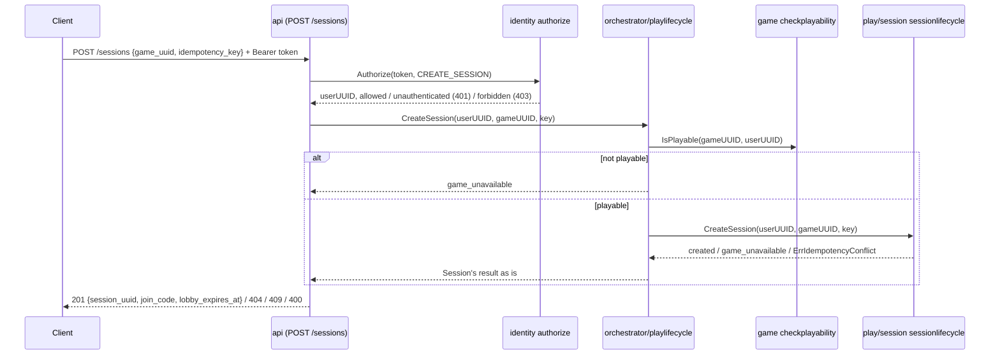
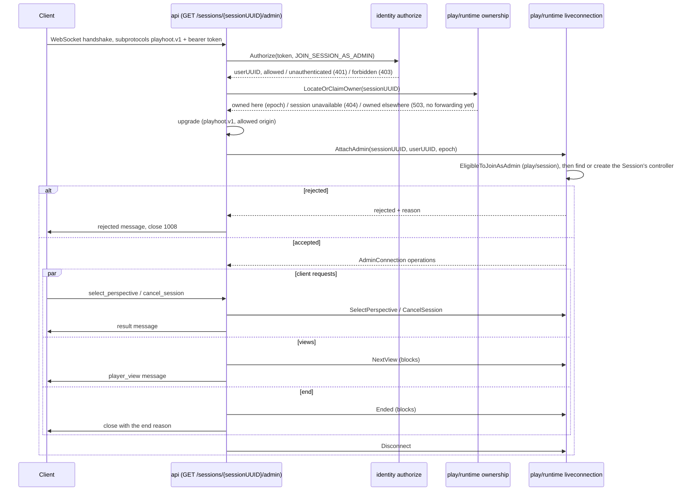

# Cross-Domain Flows

Status: CURRENT IMPLEMENTATION

Accepted cross-domain coordination rules live in `../../ARCHITECTURE.md`. Add a flow here only once it is implemented.

## Create Session

Implemented behavior:

- The API authenticates and checks coarse access through Identity, then forwards to the play-lifecycle orchestration; the creator is never part of the request body.
- The orchestration asks Game Management first, then the Session domain, which owns idempotency, the pinned version, the join code and the durable Session (see `play/docs/FLOWS.md`).
- Identity's authorization and Game Management's playability check are placeholders (fixed test tokens; always playable), recorded in each domain's `CURRENT_STATE.md`.
- Because the playability check runs before the Session domain looks at the idempotency key, a retry made after the Game stopped being playable answers `game_unavailable` instead of replaying the created Session.

## Admin Join

Implemented behavior:

- Identity and owner routing both happen before the upgrade, in that order, so an unauthorized caller never makes a Session owned. Logical admission happens after the upgrade, in the Runtime.
- The Runtime defines each kind of connection's operations and types and never sees the socket; each API endpoint maps them to and from its own JSON messages (`api/play/admin_join.go`).
- Ownership (`LocateOrClaimOwner`) is a placeholder today (every Session is owned by this instance under epoch 1). Admission is real on the Runtime side (eligibility, controller find-or-create, ADMIN connection registered), but the durable admin eligibility check answers eligible for everyone, and the admin operations answer "not implemented" (`play/CURRENT_STATE.md`). Identity's authorization is the same placeholder as for Create Session.
