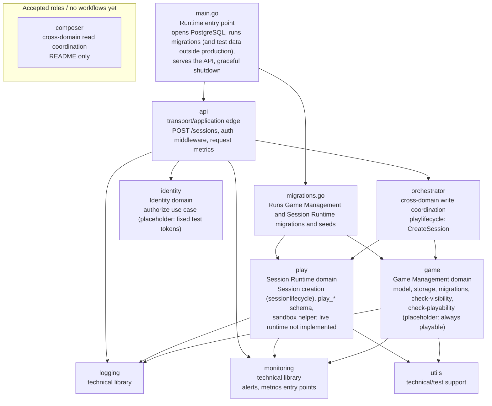

# System Map

Status: CURRENT IMPLEMENTATION

Game Management and Session Runtime are independent top-level business domains, not capabilities nested under a shared "Game" bounded context (`docs/decisions/architecture/ADR-0014-management-session-domain-split.md`). Session Runtime is being redesigned as a real-time runtime (`play/docs/decisions/SESSION-ADR-0028-real-time-session-runtime-supersedes-discrete-turn-architecture.md`); its current contents are described in `play/CURRENT_STATE.md`. The only implemented cross-domain flow is described in `CROSS_DOMAIN_FLOWS.md`.

## Repository Boundary Notes

- Some top-level directories represent unresolved/provisional boundaries.
- Composer exists as a documented role with no implemented workflows.
- See `../../ARCHITECTURE.md` for accepted architecture rules.
