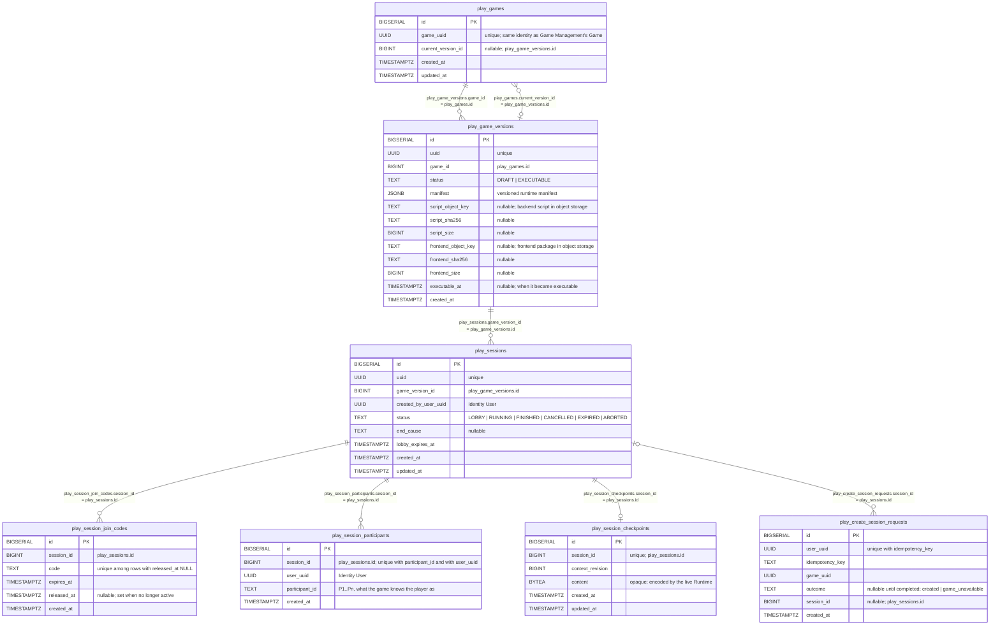

# Session Runtime - Data Model

Status: CURRENT IMPLEMENTATION

Schema owned by `play/session`, created by `play/session/internal/migrations`. Every table is prefixed with `play_`. There are no foreign keys: the relationships below are indexed columns kept correct by the application layer.

Notes:

- A Game's `current_version_id` must point to an `EXECUTABLE` version (immutable, scripts ready to run; whether the Game is published is Game Management's concern, not this domain's); this is checked by the application, and a violation is treated as broken data.
- `play_create_session_requests` rows are claimed and completed in the same transaction that creates the Session, so a committed row always has an `outcome`.
- `play_game_versions.manifest` is the version's runtime manifest: the structural facts the live Runtime needs, as `{"schema_version":1,"players":{"min":N,"max":M}}` (1 <= min <= max). It grows by adding fields; a pinned (EXECUTABLE) version must hold a valid one, and an invalid one is treated as broken data.
- A join code is active while `released_at` is NULL. An expired code is released lazily when a new Session needs that same code.
- An EXECUTABLE version must have both locators (`script_*`, `frontend_*`: object key, SHA-256 as lowercase hex, size in bytes); this is checked by the application, and a missing one is treated as broken data. Keys are content-addressed under `game-versions/backend-scripts/` and `game-versions/frontend-packages/`. The frontend package is one self-contained HTML file (decided by the human 2026-10-17 for v1); a game's assets will be resolved separately by Playhoot.
- `play_session_participants` and the first `play_session_checkpoints` row are written in the same transaction that makes a Session RUNNING, so a RUNNING Session always has its roster and a recoverable checkpoint. A checkpoint row is only replaced by one of a higher `context_revision`; there is no history (replay is a separate mechanism).
- `end_cause` is set with a terminal status; the only value written today is `GAME_START_FAILURE` (with ABORTED).
- Starting or aborting a Session releases its join codes.
