# Session Runtime - Data Model

Status: CURRENT IMPLEMENTATION

Schema owned by `play/session`, created by `play/session/internal/migrations`. Every table is prefixed with `play_`. There are no foreign keys: the relationships below are indexed columns kept correct by the application layer.

```mermaid
erDiagram
    play_games {
        BIGSERIAL id PK
        UUID game_uuid "unique; same identity as Game Management's Game"
        BIGINT current_version_id "nullable; play_game_versions.id"
        TIMESTAMPTZ created_at
        TIMESTAMPTZ updated_at
    }
    play_game_versions {
        BIGSERIAL id PK
        UUID uuid "unique"
        BIGINT game_id "play_games.id"
        TEXT status "DRAFT | EXECUTABLE"
        JSONB manifest "versioned runtime manifest"
        TEXT script_object_key "nullable; backend script in object storage"
        TEXT script_sha256 "nullable"
        BIGINT script_size "nullable"
        TEXT frontend_object_key "nullable; frontend package in object storage"
        TEXT frontend_sha256 "nullable"
        BIGINT frontend_size "nullable"
        TEXT aspect_ratio "nullable; 16:9 | 9:16 | 4:3 | 3:4 | 1:1"
        TIMESTAMPTZ executable_at "nullable; when it became executable"
        TIMESTAMPTZ created_at
    }
    play_sessions {
        BIGSERIAL id PK
        UUID uuid "unique"
        BIGINT game_version_id "play_game_versions.id"
        UUID created_by_user_uuid "Identity User"
        TEXT status "LOBBY | RUNNING | FINISHED | CANCELLED | EXPIRED | ABORTED"
        TEXT end_cause "nullable"
        TIMESTAMPTZ lobby_expires_at
        TIMESTAMPTZ expires_at "the most it may live, whatever its activity"
        TIMESTAMPTZ owner_lease_expires_at "nullable; when its live owner's lease runs out while RUNNING"
        TIMESTAMPTZ created_at
        TIMESTAMPTZ updated_at
    }
    play_session_join_codes {
        BIGSERIAL id PK
        BIGINT session_id "play_sessions.id"
        TEXT code "unique among rows with released_at NULL"
        TIMESTAMPTZ expires_at
        TIMESTAMPTZ released_at "nullable; set when no longer active"
        TIMESTAMPTZ created_at
    }
    play_session_status_changes {
        BIGSERIAL id PK
        BIGINT session_id "play_sessions.id"
        TEXT from_status "nullable; NULL for the creation"
        TEXT to_status
        TEXT end_cause "nullable"
        UUID changed_by_user_uuid "nullable; NULL when the platform changed it"
        TIMESTAMPTZ changed_at
    }
    play_session_participants {
        BIGSERIAL id PK
        BIGINT session_id "play_sessions.id; unique with participant_id and with user_uuid"
        UUID user_uuid "Identity User"
        TEXT participant_id "P1..Pn, what the game knows the player as"
        TEXT display_name "as Identity named them when the game started; empty before 20261021000000"
        TIMESTAMPTZ created_at
    }
    play_session_checkpoints {
        BIGSERIAL id PK
        BIGINT session_id "unique; play_sessions.id"
        BIGINT context_revision
        BYTEA content "opaque; encoded by the live Runtime"
        TIMESTAMPTZ created_at
        TIMESTAMPTZ updated_at
    }
    play_replays {
        BIGSERIAL id PK
        BIGINT session_id "unique; play_sessions.id"
        BIGINT game_version_id "play_game_versions.id; the pinned version replay needs"
        BIGINT final_session_time_ms "nullable; where a FINISHED game ended"
        TIMESTAMPTZ finalized_at "nullable; set once the final chunk is stored"
        TIMESTAMPTZ created_at
    }
    play_replay_chunks {
        BIGSERIAL id PK
        BIGINT session_id "play_sessions.id"
        UUID recording_uuid "one per controller run; unique with chunk_index"
        TIMESTAMPTZ recording_started_at "orders overlapping recordings"
        INT chunk_index
        INT format_version
        BIGINT from_session_time_ms
        BIGINT through_session_time_ms
        BOOLEAN final
        TEXT object_key "replays/{session}/{recording}/{index}.rpl"
        TEXT sha256
        BIGINT size "compressed bytes"
        TIMESTAMPTZ created_at
    }
    play_game_faults {
        BIGSERIAL id PK
        BIGINT session_id "play_sessions.id; unique with user_uuid and kind"
        BIGINT game_version_id "play_game_versions.id, copied from the Session"
        UUID user_uuid "the reporter, Identity User"
        TEXT participant_id "the reporter's participant"
        TEXT kind "ARTIFACT_UNREACHABLE | ARTIFACT_HASH_MISMATCH | READY_TIMEOUT | UNSUPPORTED_BRIDGE_VERSION | CONTAINER_VIOLATION | BRIDGE_ABUSE"
        JSONB detail "the client's latest evidence, at most 2 KiB"
        INTEGER occurrences "times reported"
        TIMESTAMPTZ first_reported_at
        TIMESTAMPTZ last_reported_at
    }
    play_create_session_requests {
        BIGSERIAL id PK
        UUID user_uuid "unique with idempotency_key"
        TEXT idempotency_key
        UUID game_uuid
        TEXT outcome "nullable until completed; created | game_unavailable"
        BIGINT session_id "nullable; play_sessions.id"
        TIMESTAMPTZ created_at
    }

    play_games ||--o{ play_game_versions : "play_game_versions.game_id = play_games.id"
    play_games }o--o| play_game_versions : "play_games.current_version_id = play_game_versions.id"
    play_game_versions ||--o{ play_sessions : "play_sessions.game_version_id = play_game_versions.id"
    play_sessions ||--o{ play_session_join_codes : "play_session_join_codes.session_id = play_sessions.id"
    play_sessions ||--o{ play_session_status_changes : "play_session_status_changes.session_id = play_sessions.id"
    play_sessions ||--o{ play_session_participants : "play_session_participants.session_id = play_sessions.id"
    play_sessions ||--o| play_session_checkpoints : "play_session_checkpoints.session_id = play_sessions.id"
    play_sessions ||--o| play_replays : "play_replays.session_id = play_sessions.id"
    play_game_versions ||--o{ play_replays : "play_replays.game_version_id = play_game_versions.id"
    play_sessions ||--o{ play_replay_chunks : "play_replay_chunks.session_id = play_sessions.id"
    play_sessions ||--o{ play_game_faults : "play_game_faults.session_id = play_sessions.id"
    play_game_versions ||--o{ play_game_faults : "play_game_faults.game_version_id = play_game_versions.id"
    play_sessions |o--o{ play_create_session_requests : "play_create_session_requests.session_id = play_sessions.id"
```



Notes:

- A Game's `current_version_id` must point to an `EXECUTABLE` version (immutable, scripts ready to run; whether the Game is published is Game Management's concern, not this domain's); this is checked by the application, and a violation is treated as broken data.
- `play_create_session_requests` rows are claimed and completed in the same transaction that creates the Session, so a committed row always has an `outcome`.
- `play_game_versions.manifest` is the version's runtime manifest: the structural facts the live Runtime needs, as `{"schema_version":1,"players":{"min":N,"max":M},"inputs":{...}}` (1 <= min <= max). `inputs` is optional and declares each SAMPLE input by name: `{"type":"boolean"|"number"|"vector2"|"string"|"enum", "min"/"max" (number), "nullable" (string), "values" (enum), "default"}`; an omitted input takes its default, which is the type's natural zero (false, 0, [0,0], "" or null) unless declared, and an enum, or a number whose zero is out of range, must declare it. It grows by adding fields; a pinned (EXECUTABLE) version must hold a valid one, and an invalid one is treated as broken data.
- A join code is active while `released_at` is NULL. An expired code is released lazily when a new Session needs that same code.
- An EXECUTABLE version must have both locators (`script_*`, `frontend_*`: object key, SHA-256 as lowercase hex, size in bytes); this is checked by the application, and a missing one is treated as broken data. Keys are content-addressed under `game-versions/backend-scripts/` and `game-versions/frontend-packages/`. The frontend package is one self-contained HTML file (decided by the human 2026-10-17 for v1); a game's assets will be resolved separately by Playhoot.
- `aspect_ratio` is the fixed shape the version's frontend is shown in, one of the ratios Playhoot offers (decided by the human 2026-10-20: a game picks one, it cannot declare its own). The database accepts only the offered values (`play_game_versions_aspect_ratio_check`); each has a logical resolution, 1080 units on the short side (`play/session/internal/business/gameversion`), which is not stored. Like the locators it is nullable for a DRAFT, and an EXECUTABLE version without one is checked by the application and treated as broken data. Offering another ratio changes both the constraint and that catalog.
- `play_game_faults` keeps the faults players' clients report about the game frontend of their running Session (added 2026-10-20 at the human's request: the backend must be able to audit, from the database, games with problems and tell a misbehaving game from a lying client). A row is written only while the Session is RUNNING and only for its participant under their own participant id (checked in the same statement); one row per Session, reporter and kind, so reporting again counts `occurrences` and keeps the newer `detail`. A report is the client's claim, never verified and never acted on: no Session ends and nothing is flagged because of it. Reading it: a game version reported by many distinct `user_uuid` across many Sessions points at the game; one `user_uuid` reporting many versions points at the client, for example:

  ```sql
  SELECT game_version_id, kind, COUNT(DISTINCT user_uuid) AS reporters, COUNT(DISTINCT session_id) AS sessions, SUM(occurrences) AS reports
  FROM play_game_faults GROUP BY game_version_id, kind ORDER BY reporters DESC;

  SELECT user_uuid, COUNT(DISTINCT game_version_id) AS versions, COUNT(DISTINCT session_id) AS sessions, SUM(occurrences) AS reports
  FROM play_game_faults GROUP BY user_uuid ORDER BY versions DESC;
  ```
- `play_session_participants` and the first `play_session_checkpoints` row are written in the same transaction that makes a Session RUNNING, so a RUNNING Session always has its roster and a recoverable checkpoint. While the Session is RUNNING, its live controller replaces that row every few seconds with a newer checkpoint, never with one of a lower `context_revision`; there is no history (replay is a separate mechanism).
- `end_cause` is set with a terminal status: `GAME_FINISHED` (FINISHED); `HOST_CANCELLED`, `ALL_PLAYERS_LEFT`, `PLATFORM_TERMINATED` (CANCELLED); `LOBBY_EXPIRED`, `INACTIVITY_TIMEOUT`, `MAX_LIFETIME` (EXPIRED); `GAME_START_FAILURE`, `SCRIPT_FAILURE`, `UNRECOVERABLE_INFRA_FAILURE` (ABORTED). Which statuses each cause applies from is in `play/docs/FLOWS.md` (End Session).
- `expires_at` is set at creation (creation + 4 hours, a platform tuning value) and enforced by the live controller; it is durable so it survives recovery, can be queried by a future reconciliation job, and could be shortened by platform limits.
- Starting or ending a Session releases its join codes.
- `play_session_status_changes` is the append-only history of every status a Session went through. A row is written in the same transaction as each change of `play_sessions.status`, including the creation (`from_status` NULL), and only through `sessionlifecycle`'s repository (`CreateSession`, `ChangeSessionStatus`), so no status change can skip it. `changed_by_user_uuid` is the user who caused the change (the creator creating or starting it) or NULL for the platform (for example an aborted start).
- `play_replays` and `play_replay_chunks` are the replay manifest (`play/docs/decisions/SESSION-ADR-0033-replay-recording-produces-immutable-chunks.md`). The chunk bytes are immutable objects in the private bucket, never in the database; a chunk is registered only after its object was written, so an entry always has its object (an orphan object without an entry is possible). Registering the same chunk again changes nothing. A final chunk sets `final_session_time_ms` and `finalized_at` once, before the Session becomes FINISHED; a Session that ended any other way keeps them NULL. Each controller that runs a game records its own `recording_uuid`; when recordings overlap after a recovery, the one with the later `recording_started_at` wins from its first chunk's `from_session_time_ms`. Seed data has no replay rows, since they would point at missing objects.
