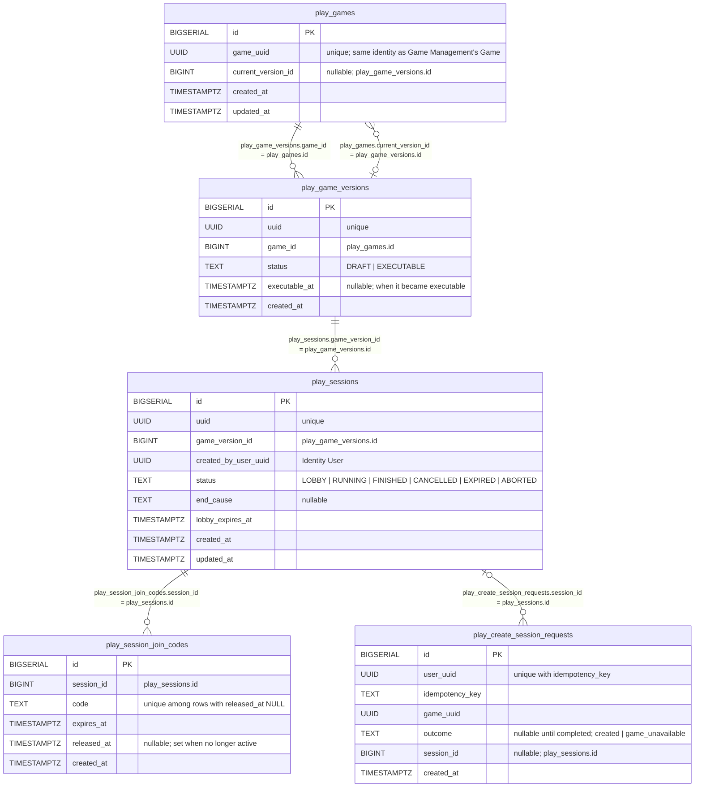

# Session Runtime - Data Model

Status: CURRENT IMPLEMENTATION

Schema owned by `play/session`, created by `play/session/internal/migrations`. Every table is prefixed with `play_`. There are no foreign keys: the relationships below are indexed columns kept correct by the application layer.

Notes:

- A Game's `current_version_id` must point to an `EXECUTABLE` version (immutable, scripts ready to run; whether the Game is published is Game Management's concern, not this domain's); this is checked by the application, and a violation is treated as broken data.
- `play_create_session_requests` rows are claimed and completed in the same transaction that creates the Session, so a committed row always has an `outcome`.
- A join code is active while `released_at` is NULL. An expired code is released lazily when a new Session needs that same code.
