# Session Runtime - Data Model

Status: CURRENT IMPLEMENTATION

Schema owned by `play/session`, created by `play/session/internal/migrations`. Every table is prefixed with `play_`. There are no foreign keys: the relationships below are indexed columns kept correct by the application layer. The database enforces only primary keys, unique constraints, indexes and column types with their nullability (`docs/engineering/standards/database-constraints.md`). The values listed below for statuses, outcomes, aspect ratios, fault kinds and sources, and every other rule, are kept by the code that writes them; code that reads every possible value of a column treats one outside its list as broken data (an alert and an error).

```mermaid
erDiagram
    play_games {
        BIGSERIAL id PK
        UUID game_uuid "unique; same identity as Game Management's Game"
        BIGINT current_version_id "nullable; play_game_versions.id"
        TIMESTAMPTZ created_at
        TIMESTAMPTZ updated_at
    }
    play_game_versions {
        BIGSERIAL id PK
        UUID uuid "unique"
        BIGINT game_id "play_games.id"
        TEXT status "DRAFT | EXECUTABLE"
        JSONB manifest "nullable for a DRAFT; versioned runtime manifest"
        TEXT script_object_key "nullable; backend script in object storage"
        TEXT script_sha256 "nullable"
        BIGINT script_size "nullable"
        TEXT frontend_object_key "nullable; frontend package in object storage"
        TEXT frontend_sha256 "nullable"
        BIGINT frontend_size "nullable"
        TEXT aspect_ratio "nullable; 16:9 | 9:16 | 4:3 | 3:4 | 1:1"
        JSONB languages "nullable; the game's languages, main first"
        TEXT script_profile "handwritten | sdk-v1"
        BIGINT current_revision "nullable; the authored sources' current revision"
        TIMESTAMPTZ executable_at "nullable; when it became executable"
        TIMESTAMPTZ created_at
    }
    play_game_version_revisions {
        BIGSERIAL id PK
        BIGINT game_version_id "play_game_versions.id; unique with number"
        BIGINT number "1, 2, ... per version"
        JSONB files "path to sha256 and size"
        TEXT source "template | web | api | mcp | restore"
        TIMESTAMPTZ created_at
    }
    play_source_files {
        BIGSERIAL id PK
        TEXT sha256 "unique; lowercase hex of content"
        TEXT content "UTF-8 source text"
        BIGINT size "bytes"
        TIMESTAMPTZ created_at
    }
    play_game_version_change_attempts {
        BIGSERIAL id PK
        BIGINT game_version_id "play_game_versions.id; unique with idempotency_key"
        TEXT idempotency_key
        TEXT request_sha256 "fingerprint of the request"
        BIGINT base_revision
        TEXT origin "web | api | mcp"
        TEXT outcome "nullable until completed; applied | conflict | invalid | not_editable"
        BIGINT revision "nullable until completed; the new revision, or the current one"
        JSONB diagnostics "nullable; why it was refused"
        TIMESTAMPTZ created_at
    }
    play_game_version_assets {
        BIGSERIAL id PK
        BIGINT game_version_id "play_game_versions.id; unique with key"
        TEXT key "logical key the frontend uses; ^[A-Za-z][A-Za-z0-9_]{0,63}$"
        TEXT type "image | audio | video"
        TEXT mime_type "closed list per type"
        TEXT object_key "nullable; NULL once the object is deleted, the row kept as a record"
        TEXT sha256 "lowercase hex"
        BIGINT size "bytes; at most 5 MiB image, 10 MiB audio, 50 MiB video"
        TIMESTAMPTZ created_at
    }
    play_game_version_input_requirements {
        BIGSERIAL id PK
        BIGINT game_version_id "unique; play_game_versions.id"
        BOOLEAN uses_keyboard "letters, digits, arrows, space"
        BOOLEAN uses_pointer_hover "moving the pointer without pressing"
        BOOLEAN uses_pointer_press "pressing or dragging with the primary button or a finger"
        TEXT devices "desktop | mobile | both; derived from the three booleans"
        TIMESTAMPTZ created_at
    }
    play_game_version_signed_urls {
        BIGSERIAL id PK
        BIGINT game_version_id "unique; play_game_versions.id"
        TEXT frontend_url "signed URL to the frontend package"
        JSONB asset_urls "signed URL of each asset with an object, by key"
        TIMESTAMPTZ expires_at "shared by every URL of the batch"
        TIMESTAMPTZ signed_at
    }
    play_sessions {
        BIGSERIAL id PK
        UUID uuid "unique"
        BIGINT game_version_id "play_game_versions.id"
        UUID created_by_user_uuid "Identity User"
        TEXT status "LOBBY | RUNNING | FINISHED | CANCELLED | EXPIRED | ABORTED"
        TEXT end_cause "nullable"
        TIMESTAMPTZ lobby_expires_at
        TIMESTAMPTZ expires_at "the most it may live, whatever its activity"
        TIMESTAMPTZ owner_lease_expires_at "nullable; when its live owner's lease runs out while RUNNING"
        TIMESTAMPTZ created_at
        TIMESTAMPTZ updated_at
    }
    play_session_join_codes {
        BIGSERIAL id PK
        BIGINT session_id "play_sessions.id"
        TEXT code "unique among rows with released_at NULL"
        TIMESTAMPTZ expires_at
        TIMESTAMPTZ released_at "nullable; set when no longer active"
        TIMESTAMPTZ created_at
    }
    play_session_status_changes {
        BIGSERIAL id PK
        BIGINT session_id "play_sessions.id"
        TEXT from_status "nullable; NULL for the creation"
        TEXT to_status
        TEXT end_cause "nullable"
        UUID changed_by_user_uuid "nullable; NULL when the platform changed it"
        TIMESTAMPTZ changed_at
    }
    play_session_participants {
        BIGSERIAL id PK
        BIGINT session_id "play_sessions.id; unique with participant_id and with user_uuid"
        UUID user_uuid "Identity User"
        TEXT participant_id "P1..Pn, what the game knows the player as"
        TEXT display_name "as Identity named them when the game started"
        TIMESTAMPTZ created_at
    }
    play_session_checkpoints {
        BIGSERIAL id PK
        BIGINT session_id "unique; play_sessions.id"
        BIGINT context_revision
        BYTEA content "opaque; encoded by the live Runtime"
        TIMESTAMPTZ created_at
        TIMESTAMPTZ updated_at
    }
    play_replays {
        BIGSERIAL id PK
        BIGINT session_id "unique; play_sessions.id"
        BIGINT game_version_id "play_game_versions.id; the pinned version replay needs"
        BIGINT final_session_time_ms "nullable; where a FINISHED game ended"
        TIMESTAMPTZ finalized_at "nullable; set once the final chunk is stored"
        TIMESTAMPTZ created_at
    }
    play_replay_chunks {
        BIGSERIAL id PK
        BIGINT session_id "play_sessions.id"
        UUID recording_uuid "one per controller run; unique with chunk_index"
        TIMESTAMPTZ recording_started_at "orders overlapping recordings"
        INT chunk_index
        INT format_version
        BIGINT from_session_time_ms
        BIGINT through_session_time_ms
        BOOLEAN final
        TEXT object_key "replays/{session}/{recording}/{index}.rpl"
        TEXT sha256
        BIGINT size "compressed bytes"
        TIMESTAMPTZ created_at
    }
    play_game_fault_reports {
        BIGSERIAL id PK
        BIGINT session_id "play_sessions.id"
        BIGINT game_version_id "play_game_versions.id, copied from the Session"
        UUID user_uuid "the reporter, or the user who hit a limit; Identity User"
        TEXT participant_id "nullable; their participant (a SERVER record of an admin has none)"
        TEXT source "CLIENT (a client's report) | SERVER (what the platform enforced or refused)"
        TEXT kind "CLIENT: ARTIFACT_UNREACHABLE | ARTIFACT_HASH_MISMATCH | READY_TIMEOUT | UNSUPPORTED_BRIDGE_VERSION | CONTAINER_VIOLATION | BRIDGE_ABUSE; SERVER: SERVER_LIMIT | INVALID_SAMPLE | INVALID_COMMAND"
        JSONB detail "CLIENT: the client's evidence, at most 2 KiB; SERVER_LIMIT: the limit's name; INVALID_*: the refusal's reason (and command)"
        INTEGER occurrences "1 for a report; for SERVER_LIMIT, the refusals since the previous audit flush"
        TIMESTAMPTZ reported_at
    }
    play_create_session_requests {
        BIGSERIAL id PK
        UUID user_uuid "unique with idempotency_key"
        TEXT idempotency_key
        UUID game_uuid
        TEXT outcome "nullable until completed; created | game_unavailable"
        BIGINT session_id "nullable; play_sessions.id"
        TIMESTAMPTZ created_at
    }

    play_games ||--o{ play_game_versions : "play_game_versions.game_id = play_games.id"
    play_games }o--o| play_game_versions : "play_games.current_version_id = play_game_versions.id"
    play_game_versions ||--o{ play_sessions : "play_sessions.game_version_id = play_game_versions.id"
    play_game_versions ||--o{ play_game_version_assets : "play_game_version_assets.game_version_id = play_game_versions.id"
    play_game_versions ||--o| play_game_version_input_requirements : "play_game_version_input_requirements.game_version_id = play_game_versions.id"
    play_game_versions ||--o| play_game_version_signed_urls : "play_game_version_signed_urls.game_version_id = play_game_versions.id"
    play_sessions ||--o{ play_session_join_codes : "play_session_join_codes.session_id = play_sessions.id"
    play_sessions ||--o{ play_session_status_changes : "play_session_status_changes.session_id = play_sessions.id"
    play_sessions ||--o{ play_session_participants : "play_session_participants.session_id = play_sessions.id"
    play_sessions ||--o| play_session_checkpoints : "play_session_checkpoints.session_id = play_sessions.id"
    play_sessions ||--o| play_replays : "play_replays.session_id = play_sessions.id"
    play_game_versions ||--o{ play_replays : "play_replays.game_version_id = play_game_versions.id"
    play_sessions ||--o{ play_replay_chunks : "play_replay_chunks.session_id = play_sessions.id"
    play_sessions ||--o{ play_game_fault_reports : "play_game_fault_reports.session_id = play_sessions.id"
    play_game_versions ||--o{ play_game_fault_reports : "play_game_fault_reports.game_version_id = play_game_versions.id"
    play_sessions |o--o{ play_create_session_requests : "play_create_session_requests.session_id = play_sessions.id"
```



Notes:

- A Game's `current_version_id` must point to an `EXECUTABLE` version (immutable, scripts ready to run; whether the Game is published is Game Management's concern, not this domain's); this is checked by the application, and a violation is treated as broken data.
- `play_create_session_requests` rows are claimed and completed in the same transaction that creates the Session, so a committed row always has an `outcome`.
- `play_game_versions.manifest` is the version's runtime manifest: the structural facts the live Runtime needs, as `{"schema_version":1,"players":{"min":N,"max":M},"inputs":{...}}` (1 <= min <= max). `inputs` is optional and declares each SAMPLE input by name: `{"type":"boolean"|"number"|"vector2"|"string"|"enum", "min"/"max" (number), "nullable" (string), "values" (enum), "default"}`; an omitted input takes its default, which is the type's natural zero (false, 0, [0,0], "" or null) unless declared, and an enum, or a number whose zero is out of range, must declare it. It grows by adding fields; a pinned (EXECUTABLE) version must hold a valid one, and an invalid one is treated as broken data.
- A join code is active while `released_at` is NULL. An expired code is released lazily when a new Session needs that same code. A code is resolved by its most recent row, released or not (`play_session_join_codes_code_idx` on `(code, id)`), together with that Session's status (`play/docs/FLOWS.md`, Join Code Resolution); released rows are kept for this.
- An EXECUTABLE version must have both locators (`script_*`, `frontend_*`: object key, SHA-256 as lowercase hex, size in bytes); this is checked by the application, and a missing one is treated as broken data. Keys are content-addressed under `game-versions/backend-scripts/`, `game-versions/frontend-packages/` and `game-versions/assets/`. The frontend package is one self-contained HTML file (decided by the human 2026-10-17 for v1); its media are the version's assets.
- `play_game_version_assets` are the media a version's frontend uses, by logical key (added 2026-10-25, decided by the human: `play/docs/decisions/SESSION-ADR-0034-game-assets-and-shared-signed-access.md`). Types and MIME types are a closed catalog (`image`: `image/png`, `image/webp`, `image/jpeg`, `image/svg+xml`; `audio`: `audio/mpeg`, `audio/ogg`, `audio/wav`; `video`: `video/mp4`, `video/webm`; `play/session/internal/business/gameversion`). The database enforces only one key per version (`docs/engineering/standards/database-constraints.md`); the application enforces the key pattern, the type, the MIME type and size for the type, lowercase hex hashes and the 100 MiB a version's assets may weigh together, counting the assets with an object; an EXECUTABLE version breaking any rule is treated as broken data. A row without `object_key` records an asset whose object was deleted (the future publishing flow deletes uploaded assets the frontend does not declare); it is not delivered. An EXECUTABLE version's assets never change.
- `play_game_version_signed_urls` is each version's current batch of signed URLs, shared by every Session of the version on every instance (added 2026-10-25, SESSION-ADR-0034): the frontend package's and every asset with an object's, all expiring at `expires_at` (signed for 24 hours). There is no history: a new batch replaces the row as a whole, and only when it expires later than the stored one, so concurrent signers keep the longest-lived. The URLs are bearer credentials to the version's objects until they expire.
- `play_game_version_input_requirements` holds, one row per version, the interactions its game uses and the device classes that can play it (added 2026-10-25, decided by the human: `play/docs/decisions/SESSION-ADR-0035-game-input-requirements-and-player-device-check.md`). They are columns, not manifest JSON, so a future game directory can filter on them; `play_game_version_input_requirements_devices_idx` on `(devices, game_version_id)` serves that filter. `devices` is computed by the writer from the booleans (`play/internal/business/inputrequirements`): `both` when the game uses no keyboard and at most one of hover or press, `desktop` otherwise; `mobile` is valid and reserved, never produced yet. The database enforces only one row per version; an EXECUTABLE version without a row, or with `devices` outside the three values, is treated as broken data. Seeded versions are pressed/dragged only, on `both`.
- A DRAFT version's authored sources (added 2026-11-01, game creation project, `play/session/workflows/versiondrafting`): a DRAFT is changed in place, and each change is a new revision of the same version. `current_revision` is NULL for a version without authored sources (the handwritten seeds) and moves one by one through a conditional update over the base the change was made over, so two changes over the same base never both apply; `play_game_version_revisions` is its write-once history, one row per number. A revision lists its files as `{path: {sha256, size}}`; each content is stored once in `play_source_files`, by hash, and shared by every revision and version holding it. `play_game_version_change_attempts` keeps every change sent, applied or refused, under its idempotency key (unique per version): claimed and completed in the same transaction, so a committed row always has `outcome` and `revision` (written once); `revision` is the new one when applied, otherwise the version's current one when decided. `play_game_versions_one_draft_idx` lets a game hold at most one DRAFT. A DRAFT has no `manifest` until it is built.
- A DRAFT's assets (added 2026-11-02, `play/session/workflows/versiondrafting`): a project declares its assets in `game.project.json`; each revision also pins, in `play_game_version_revisions.assets` (`{key: {sha256, size, mime_type}}`), the content bound to each key, so a build always uses exact bytes. Checked content is stored content-addressed under `game-versions/assets/`; `play_asset_objects` registers every object Play may hold, bound or not, once per hash and before the object is stored (`docs/engineering/standards/object-storage.md`), so an upload that failed after registering leaves only a row its cleanup handles; `deleted_at` is written once when a publication deletes objects no published version uses (that cleanup is the publication's, item J). `play_game_version_change_attempts.kind` says what an attempt tried (`change`, `restore`, `asset_upload`, `asset_removal`). An upload refused before its content was read (`not_declared`, `not_editable`) or at its size limit (`too_large`) is recorded under a generated key starting `refused-before-content:`, never the caller's, so a retry with that key is decided again.
- A preview (added 2026-11-02, `play/session/workflows/previewlifecycle`): `play_previews` holds one row per preview of a draft version: `uuid`, `game_version_id`, `revision` (the build it plays), `owner_user_uuid`, `participants` (their count, P1..Pn), `created_at`, `expires_at`, and `ended_at` with `end_reason` (`finished`, `idle`, `ended_by_owner`, `replaced`, `script_failure`, `unavailable`), written once when it ends. A partial unique index keeps at most one running preview (`ended_at IS NULL`) per version. Kept apart from `play_sessions` on purpose: a preview is never a Session.
- A DRAFT revision's build (added 2026-11-02, `play/session/workflows/versiondrafting` queues it, `play/session/workflows/versionbuilding` runs it): `play_game_version_builds` holds one row per revision (unique `(game_version_id, revision)`), created `QUEUED` in the transaction that made the revision. Its `status` changes more than once (`QUEUED` → `RUNNING` → `SUCCEEDED` | `FAILED`; `QUEUED` → `SUPERSEDED` when a newer revision of the version is queued; `RUNNING` → `QUEUED` when an instance restarts with it running), so every change is appended to `play_game_version_build_status_changes` (`from_status` null for the first) in the same transaction (`data-history.md` rule 2); a build's start is its latest change to `RUNNING`. Everything its end decided is written once, with `finished_at` (rule 1): `inputs_sha256` (hash of the revision's file and asset hashes and the toolchain version, `business/build`), `toolchain_version`, `diagnostics`, the locators of the stored `server.js` and `client.html` (`server_*`, `client_*`, content-addressed under `game-versions/backend-scripts/` and `game-versions/frontend-packages/`, the prefixes executable versions use), `manifest`, `aspect_ratio`, `languages` (the JSON list of the languages `game.project.json` declares, main first; publishing copies it into `play_game_versions.languages`, 2026-11-02), `uses_keyboard` / `uses_pointer_hover` / `uses_pointer_press` (what the client asks of the device, read by the toolchain from its sources; publishing copies them into the version's input requirements, 2026-11-02), and `reused_build_id` when it took the artifacts of an earlier succeeded build with the same inputs instead of building. `play_build_artifact_objects` registers every built object Play may hold, once per hash and before it is stored (`docs/engineering/standards/object-storage.md`); `deleted_at` is for a publication's cleanup (item J). The manifest stays in the row, as executable versions keep theirs, rather than as an object.
- `script_profile` is the profile the backend script is checked and run under (`play/runtime/sandbox/scriptcheck.Profile`, 2026-11-01): `handwritten` or `sdk-v1` (built by the frontend's game tools). Not null, without default: every writer sets it (seeds included). A reader that finds another value treats the version as broken data.
- `languages` is the JSON list of the languages an executable version's game is written in, its main one first (`gameversion.Languages`: Playhoot's languages, the same list as the SDK's `gameLanguages`); null for a DRAFT. Set when the version is frozen, from its build; an executable version without valid ones is broken data (2026-11-02).
- `aspect_ratio` is the fixed shape the version's frontend is shown in, one of the ratios Playhoot offers (decided by the human 2026-10-20: a game picks one, it cannot declare its own). Only the offered values are valid, kept by the application (the database enforces none); each has a logical resolution, 1080 units on the short side (`play/session/internal/business/gameversion`), which is not stored. Like the locators it is nullable for a DRAFT, and an EXECUTABLE version without one, or with one not offered, is checked by the application and treated as broken data. Offering another ratio changes that catalog only.
- `play_game_fault_reports` also keeps, as `source = 'SERVER'` and `kind = 'SERVER_LIMIT'`, the platform's rate and resource limits a live Session's users hit (added 2026-10-21 at the human's request: every limit hit within a Session is to be persisted, best effort). One row per limit, user and audit flush: `detail.limit` names the limit (`api.<message type or lane>.rate|queue`, `api.connection.messages|bytes`, `runtime.<limit>` such as `runtime.command_participant_rate` or `runtime.views_collapsed`) and `occurrences` how many times it refused since the previous flush. Hits are gathered in memory and written every 5 s (and once more on shutdown), each flush in one transaction; a failed write is logged and dropped. Such a record is written for any status of an existing Session, an admin's without a participant id. A CLIENT record always has its participant and one of the client kinds, a SERVER record one of the server kinds (`SERVER_LIMIT` from `recordlimithits`; `INVALID_SAMPLE` and `INVALID_COMMAND` from `recordgamefault`, always with their participant), and `occurrences` is always positive: kept by the two writers (`recordgamefault`, checking each kind against its source in `play/session/internal/business/gamefault`, and `recordlimithits`), not by the database.
- `play_game_fault_reports` also keeps, as `source = 'SERVER'` and `kind = 'INVALID_SAMPLE'` or `'INVALID_COMMAND'`, the SAMPLEs and COMMANDs a participant's game frontend sent that do not match the game's declared inputs and commands (decided by the human 2026-10-25: data the game declares nothing for is an error of the game's frontend script; the platform ends that player's connection, `play/docs/FLOWS.md`, Invalid Game Data). Written like a client's report, only while the Session is RUNNING and for that participant, one row per refusal: `{"reason":...}` for a SAMPLE (which input and why, such as `invalid input value: jump is not a declared input`), `{"command":...,"reason":...}` for a COMMAND (its name and why, such as `undeclared command: fly` or `invalid input value: x is out of range`); the reason is cut to 200 bytes and the name to 64. Unlike a client's report, it is what the platform saw: it points at the game version's frontend, or at a client sending data itself.
- `play_game_fault_reports` keeps the faults players' clients report about the game frontend of their running Session (added 2026-10-20 at the human's request: the backend must be able to audit, from the database, games with problems and tell a misbehaving game from a lying client). A row is written only while the Session is RUNNING and only for its participant under their own participant id (`recordgamefault` checks it before writing); every report is its own row, never updated (`docs/engineering/standards/data-history.md`), so the history of what was reported, and when, stays. A report is the client's claim, never verified and never acted on: no Session ends and nothing is flagged because of it. Reading it: a game version reported by many distinct `user_uuid` across many Sessions points at the game; one `user_uuid` reporting many versions points at the client, for example:

  ```sql
  SELECT game_version_id, kind, COUNT(DISTINCT user_uuid) AS reporters, COUNT(DISTINCT session_id) AS sessions, SUM(occurrences) AS reports
  FROM play_game_fault_reports GROUP BY game_version_id, kind ORDER BY reporters DESC;

  SELECT user_uuid, COUNT(DISTINCT game_version_id) AS versions, COUNT(DISTINCT session_id) AS sessions, SUM(occurrences) AS reports
  FROM play_game_fault_reports GROUP BY user_uuid ORDER BY versions DESC;

  -- What the platform refused, per user, next to what their client reported, in one Session
  SELECT user_uuid, source, kind, occurrences, detail, reported_at
  FROM play_game_fault_reports WHERE session_id = 42 ORDER BY reported_at;
  ```

  A SERVER record next to a CLIENT report of the same user and Session is the strongest sign: the client said the game abused it, and the platform saw the traffic. A SERVER record alone, from a client that never reported, points at a client sending traffic itself.
- `play_session_participants` and the first `play_session_checkpoints` row are written in the same transaction that makes a Session RUNNING, so a RUNNING Session always has its roster and a recoverable checkpoint. While the Session is RUNNING, its live controller replaces that row every few seconds with a newer checkpoint, never with one of a lower `context_revision`; there is no history (replay is a separate mechanism).
- `end_cause` is set with a terminal status: `GAME_FINISHED` (FINISHED); `HOST_CANCELLED`, `ALL_PLAYERS_LEFT`, `PLATFORM_TERMINATED` (CANCELLED); `LOBBY_EXPIRED`, `INACTIVITY_TIMEOUT`, `MAX_LIFETIME` (EXPIRED); `GAME_START_FAILURE`, `SCRIPT_FAILURE`, `UNRECOVERABLE_INFRA_FAILURE` (ABORTED). Which statuses each cause applies from is in `play/docs/FLOWS.md` (End Session).
- `expires_at` is set at creation (creation + 4 hours, a platform tuning value) and enforced by the live controller; it is durable so it survives recovery, can be queried by a future reconciliation job, and could be shortened by platform limits.
- Starting or ending a Session releases its join codes.
- `play_session_status_changes` is the append-only history of every status a Session went through. A row is written in the same transaction as each change of `play_sessions.status`, including the creation (`from_status` NULL), and only through `sessionlifecycle`'s repository (`CreateSession`, `ChangeSessionStatus`), so no status change can skip it. `changed_by_user_uuid` is the user who caused the change (the creator creating or starting it) or NULL for the platform (for example an aborted start).
- `play_replays` and `play_replay_chunks` are the replay manifest (`play/docs/decisions/SESSION-ADR-0033-replay-recording-produces-immutable-chunks.md`). The chunk bytes are immutable objects in the private bucket, never in the database; a chunk is registered only after its object was written, so an entry always has its object (an orphan object without an entry is possible). Registering the same chunk again changes nothing. A final chunk sets `final_session_time_ms` and `finalized_at` once, before the Session becomes FINISHED; a Session that ended any other way keeps them NULL. Each controller that runs a game records its own `recording_uuid`; when recordings overlap after a recovery, the one with the later `recording_started_at` wins from its first chunk's `from_session_time_ms`. Seed data has no replay rows, since they would point at missing objects.


## Publishing (2026-11-02)

`play_asset_objects.registered_at` and `play_build_artifact_objects.registered_at` are when the content was last registered to be stored (the cleanup never takes content registered in the last hour for unused); the hashes the cleanup's reference checks read are indexed (`play_game_versions.script_sha256`, `frontend_sha256`, `play_game_version_assets.sha256`). A published (frozen) version is a `play_game_versions` row in `EXECUTABLE` with `executable_at`, its locators, manifest and aspect ratio copied from its build, its `play_game_version_assets` rows and its `play_game_version_input_requirements` row; its revisions and builds stay as history.
