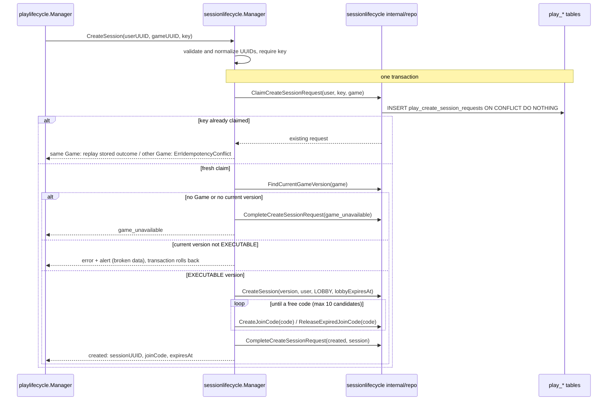

# Session Runtime - Flows

Status: CURRENT IMPLEMENTATION

## Create Session

`sessionlifecycle.Manager.CreateSession(userUUID, gameUUID, idempotencyKey)`, called by the play-lifecycle orchestration once Game Management said the Game is playable (see `docs/architecture/CROSS_DOMAIN_FLOWS.md`).

Implemented behavior:

- Idempotent per `(userUUID, idempotencyKey)`. The claim, the Session, its join code and the recorded outcome commit together, so a committed request always has an outcome; two concurrent identical requests produce one Session and the same answer.
- A retry with the same key and Game replays the first answer, including `game_unavailable` even if the Game became playable since. The same key with another Game is `ErrIdempotencyConflict`.
- The Session pins the Game's current version, which must be `EXECUTABLE` (immutable, scripts ready to run). A current version in any other state is treated as broken data: alert, error, nothing persisted.
- The Session starts in `LOBBY` with a 30-minute lobby; its join code expires with the lobby. Join codes are 6 characters from an alphabet without look-alike characters; a code held by an active join code is skipped, one held by an expired join code is released and reused.
- No Runtime controller and no participant are created; the creator is not a player.
- Counts `play_session_create_total{outcome=created|game_unavailable|replayed}` once the transaction committed.
