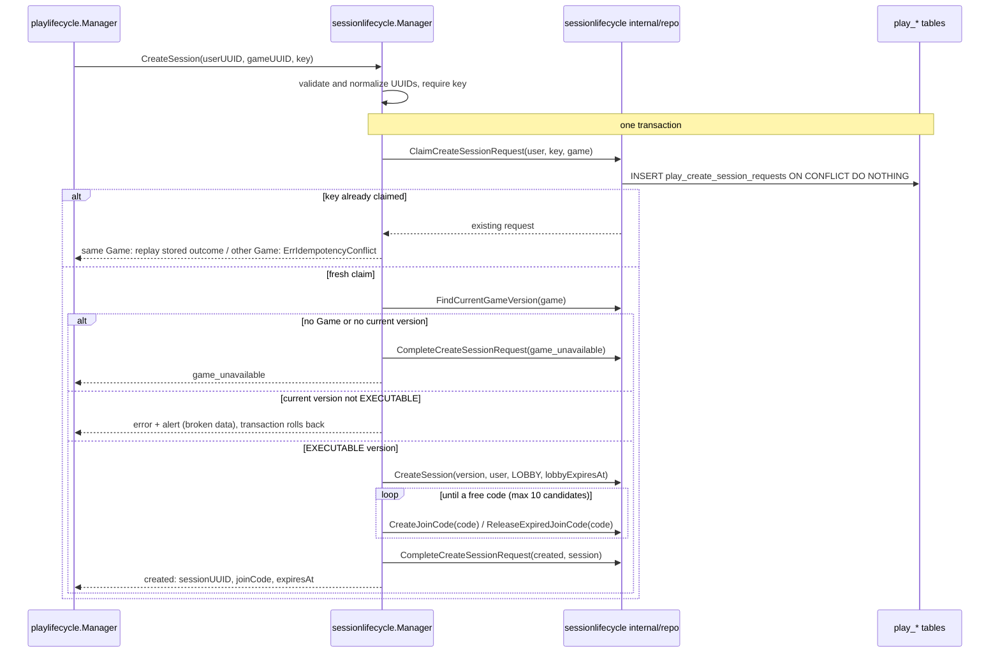

# Session Runtime - Flows

Status: CURRENT IMPLEMENTATION

## Create Session

`sessionlifecycle.Manager.CreateSession(userUUID, gameUUID, idempotencyKey)`, called by the play-lifecycle orchestration once Game Management said the Game is playable (see `docs/architecture/CROSS_DOMAIN_FLOWS.md`).

Implemented behavior:

- Idempotent per `(userUUID, idempotencyKey)`. The claim, the Session, its join code and the recorded outcome commit together, so a committed request always has an outcome; two concurrent identical requests produce one Session and the same answer.
- A retry with the same key and Game replays the first answer, including `game_unavailable` even if the Game became playable since. The same key with another Game is `ErrIdempotencyConflict`.
- The Session pins the Game's current version, which must be `EXECUTABLE` (immutable, scripts ready to run). A current version in any other state is treated as broken data: alert, error, nothing persisted.
- The Session starts in `LOBBY` with a 30-minute lobby; its join code expires with the lobby. Join codes are 6 characters from an alphabet without look-alike characters; a code held by an active join code is skipped, one held by an expired join code is released and reused.
- No Runtime controller and no participant are created; the creator is not a player.
- Counts `play_session_create_total{outcome=created|game_unavailable|replayed}` once the transaction committed.

## Admin Join Eligibility

`checkadminjoin.Service.EligibleToJoinAsAdmin(sessionUUID, userUUID)`, called by the live Runtime before it attaches an admin connection (see `docs/architecture/CROSS_DOMAIN_FLOWS.md`, Admin Join). It only reads `play_sessions`.

| Session | Answer |
| --- | --- |
| No Session with that UUID (or not a UUID) | `session_not_found` |
| Created by another user | `not_creator` (whatever its state) |
| RUNNING | `eligible` |
| LOBBY with `lobby_expires_at` still in the future | `eligible` |
| LOBBY past `lobby_expires_at` | `session_not_joinable`; the expiry is not recorded here |
| FINISHED, CANCELLED, EXPIRED, ABORTED | `session_not_joinable` |

## Join Code Resolution

`resolvejoincode.Service.ResolveJoinCode(joinCode)`, called by the API before owner routing when a player joins by join code (`GET /join/{joinCode}`). It only reads `play_session_join_codes` joined with `play_sessions`. The code is matched in upper case, so codes typed in lower case resolve too.

| Join code | Answer |
| --- | --- |
| Unreleased row holding the code, `expires_at` still in the future | `found`, with that Session's UUID |
| Unreleased row past `expires_at` | `not_found`; the code is not released here |
| Only released rows, or no row | `not_found` |

The Session's state is not checked: a code expires with its lobby, and a Session that already started is rejected by the Runtime's admission (`session_started`).

## Player Join Eligibility

`checkplayerjoin.Service.EligibleToJoinAsPlayer(sessionUUID)`, called by the live Runtime before it admits a player into the lobby. It only reads `play_sessions`; any user may join, the creator included.

| Session | Answer |
| --- | --- |
| No Session with that UUID (or not a UUID) | `session_not_found` |
| LOBBY with `lobby_expires_at` still in the future | `eligible` |
| LOBBY past `lobby_expires_at` | `session_not_joinable`; the expiry is not recorded here |
| RUNNING | `session_started` |
| FINISHED, CANCELLED, EXPIRED, ABORTED | `session_not_joinable` |

The lobby's capacity is not checked here: the live controller checks it against the manifest's maximum while admitting.

## Runtime Manifest Load

`loadruntimemanifest.Service.LoadRuntimeManifest(sessionUUID)`, called by the live Runtime when it creates a Session's controller, which keeps the manifest for the Session's lifetime (it cannot change: the version is pinned and immutable). It reads `play_sessions` joined with `play_game_versions`. An unknown Session is `ErrSessionNotFound`; a pinned version that is missing or holds an invalid manifest raises an alert and is an error.
