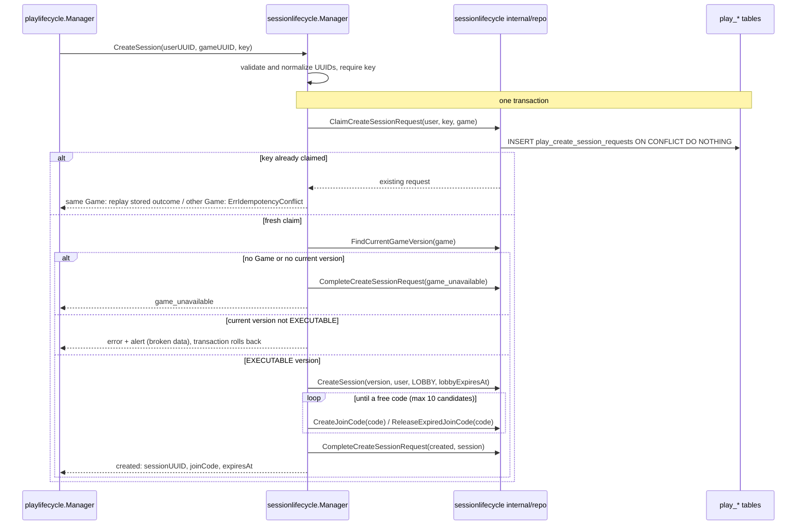
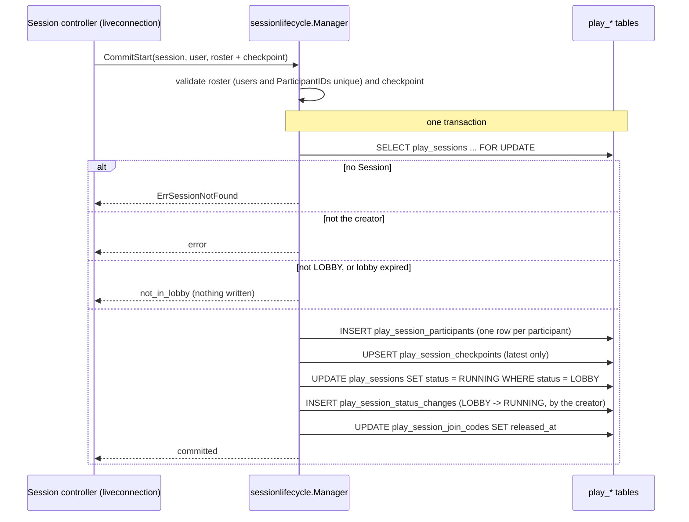

# Session Runtime - Flows

Status: CURRENT IMPLEMENTATION

## Create Session

`sessionlifecycle.Manager.CreateSession(userUUID, gameUUID, idempotencyKey)`, called by the play-lifecycle orchestration once Game Management said the Game is playable (see `docs/architecture/CROSS_DOMAIN_FLOWS.md`).

Implemented behavior:

- Idempotent per `(userUUID, idempotencyKey)`. The claim, the Session, its join code and the recorded outcome commit together, so a committed request always has an outcome; two concurrent identical requests produce one Session and the same answer.
- A retry with the same key and Game replays the first answer, including `game_unavailable` even if the Game became playable since. The same key with another Game is `ErrIdempotencyConflict`.
- The Session pins the Game's current version, which must be `EXECUTABLE` (immutable, scripts ready to run). A current version in any other state is treated as broken data: alert, error, nothing persisted.
- The Session starts in `LOBBY` with a 30-minute lobby; its join code expires with the lobby. Join codes are 6 characters from an alphabet without look-alike characters; a code held by an active join code is skipped, one held by an expired join code is released and reused.
- No Runtime controller and no participant are created; the creator is not a player.
- Counts `play_session_create_total{outcome=created|game_unavailable|replayed}` once the transaction committed.

## Live Session Check

`checklivesession.Service.CheckLiveSession(sessionUUID)`, called by the Runtime's ownership (`LocateOrClaimOwner`) before every live upgrade, so that only a live Session is ever claimed and gets a controller. It only reads `play_sessions` (`status`, `lobby_expires_at`, `end_cause`) and answers one outcome, counted in `play_session_live_checks_total{outcome}`:

- `live`: RUNNING, or LOBBY before `lobby_expires_at`;
- `not_found`: no Session has that UUID, or it is not a UUID;
- `ended`: FINISHED, CANCELLED, EXPIRED or ABORTED, with that status and its `end_cause`; a terminal status without an end cause raises an alert and is an error;
- `lobby_expired`: LOBBY past `lobby_expires_at` (the expiry is not recorded here; reconciliation ends it later as EXPIRED / LOBBY_EXPIRED).

Any other status raises an alert and is an error. The Runtime's ownership answers `session_not_found`, `session_ended` (with the status and end cause) or `session_unavailable` for them, and the API refuses the connection after the upgrade as `invalid_session`, `session_ended` (with `status` and `end_cause`) or `session_unavailable` (`api/README.md`), decided by the human 2026-10-25. An overdue lobby keeps `session_unavailable`, consistently with a join by code, which answers `join_code_expired` for it rather than the ended Session's `invalid_join_code`: nothing recorded its end yet.

## Admin Join Eligibility

`checkadminjoin.Service.EligibleToJoinAsAdmin(sessionUUID, userUUID)`, called by the live Runtime before it attaches an admin connection (see `docs/architecture/CROSS_DOMAIN_FLOWS.md`, Admin Join). It only reads `play_sessions`.

| Session | Answer |
| --- | --- |
| No Session with that UUID (or not a UUID) | `session_not_found` |
| Created by another user | `not_creator` (whatever its state) |
| RUNNING | `eligible` |
| LOBBY with `lobby_expires_at` still in the future | `eligible` |
| LOBBY past `lobby_expires_at` | `session_not_joinable`; the expiry is not recorded here |
| FINISHED, CANCELLED, EXPIRED, ABORTED | `session_not_joinable` |
| Any other status (broken data) | alert and error |

## Join Code Resolution

`resolvejoincode.Service.ResolveJoinCode(joinCode)`, called by the API before owner routing when a player joins by join code (`GET /v1/play/join/{joinCode}`). It only reads `play_session_join_codes` joined with `play_sessions`. The code is matched in upper case, so codes typed in lower case resolve too.

The code is decided by its most recent assignment (its newest row, released or not) and that Session's status (decided by the human 2026-10-21). A code is only given again once its previous row was released, so the newest row is the current one, and a reused code answers for its newest Session. Releasing at start or end and recycling expired codes at creation are unchanged; the code's expiry only matters in the lobby, since a code can expire while its Session is still played.

| Most recent assignment of the code | Answer |
| --- | --- |
| Session in `LOBBY`, `expires_at` still in the future | `found`, with that Session's UUID |
| Session in `LOBBY`, past `expires_at` | `expired` (it no longer accepts players); the code is not released here |
| Session `RUNNING` (left its lobby, not ended) | `session_started` |
| Session FINISHED, CANCELLED, EXPIRED or ABORTED | `invalid`: a finished Session's code is treated as deleted |
| Session in any other status (broken data) | alert and error |
| No row | `invalid` |

Only `found` carries the Session's UUID. Metric `play_session_join_codes_resolved_total{outcome}`.

## Player Join Eligibility

`checkplayerjoin.Service.EligibleToJoinAsPlayer(sessionUUID)`, called by the live Runtime before it admits a player into the lobby. It only reads `play_sessions`; any user may join, the creator included.

| Session | Answer |
| --- | --- |
| No Session with that UUID (or not a UUID) | `session_not_found` |
| LOBBY with `lobby_expires_at` still in the future | `eligible` |
| LOBBY past `lobby_expires_at` | `session_not_joinable`; the expiry is not recorded here |
| RUNNING | `session_started` |
| FINISHED, CANCELLED, EXPIRED, ABORTED | `session_not_joinable` |
| Any other status (broken data) | alert and error |

The lobby's capacity is not checked here: the live controller checks it against the manifest's maximum while admitting. Nor is the player's device: the controller checks it first, on every player connection (Player Device Check).

## Runtime Manifest Load

`loadruntimemanifest.Service.LoadRuntimeManifest(sessionUUID)`, called by a Session's live controller on its first admitted connection, which keeps the manifest for the Session's lifetime (it cannot change: the version is pinned and immutable). It reads `play_sessions` joined with `play_game_versions`. The manifest declares the player limits, the SAMPLE inputs and the COMMANDs, each command with payload fields declared like inputs (`play/internal/business/commands`). It also reads the version's row in `play_game_version_input_requirements` (the interactions the game uses and the devices that can play it). An unknown Session is `ErrSessionNotFound`; a pinned version that is missing, holds an invalid manifest, has no input requirements or has `devices` other than `desktop`, `mobile` or `both` raises an alert and is an error.

## Player Device Check

Decided by the human 2026-10-25 (`play/docs/decisions/SESSION-ADR-0035-game-input-requirements-and-player-device-check.md`): only a device that can play the Session's game attaches as a player.

1. The client names its class in the `device` query parameter of either player endpoint (`desktop` or `mobile`); the API passes it to the Runtime as it came.
2. The Session's controller (`liveconnection`, `attachPlayer`) checks the device on every player connection (lobby join, reattach, rejoin and device switch), only once the Session admits the player (decided by the human 2026-10-25): a participant of the game running here; or, from the durable eligibility, a lobby that accepts players, or a running Session recovered here that the player plays. A Session that cannot be joined answers its own reason whatever the device: `session_unavailable` when not found or not joinable, `session_started` for a non-participant of a running game. The device check comes before the lobby's capacity, a reattach or a rejoin, so a refused connection neither takes a lobby place, replaces the player's current connection nor asks the game about a rejoin. The manifest with the input requirements is loaded once per controller when first needed.
3. The rule (`play/internal/business/inputrequirements`, shared by `play/session` and `play/runtime`): `desktop` plays a version whose `devices` is `desktop` or `both`, `mobile` one whose `devices` is `mobile` or `both`. A missing or unknown device plays nothing. `devices` other than the three values raises an alert and is an error.
4. A refused device is rejected `device_not_supported` with the version's requirements; the API sends `{"type":"rejected","reason":"device_not_supported","requirements":{"devices":...,"uses_keyboard":...,"uses_pointer_hover":...,"uses_pointer_press":...}}` and closes `1008` `admission rejected`. Counted in `play_runtime_player_attach_total{outcome="device_not_supported"}`; the attach log carries `device` (the class, or `unknown`).
5. Admins are never checked.

Which devices a version allows is computed by whoever writes its requirements (`inputrequirements.DevicesFor`, checked by `Requirements.Validate`): `both` when it uses no keyboard and at most one of hover or press, `desktop` otherwise. `mobile` is reserved; the rule never produces it. Today only the seed migrations write requirements, through that rule.

Required in the future (not built): games receive input only through Playhoot SDK built-in functions (keyboard, hover, press/drag); publishing a version runs a static analysis of its frontend script that infers which of them it uses and writes its requirements through the rule; a game directory filters games by `devices` for the visitor's device class.

## Start Session (durable side)

Called by the live Runtime while it starts a Session's game (the Session's controller in `play/runtime/workflows/liveconnection`, `startSession`, on its main goroutine): first the eligibility check, then the frontend access, then, once the game's `start()` and first projections succeeded, either the commit or, after a second script failure, the abort.

### Start Eligibility

`sessionlifecycle.Manager.CheckStartEligibility(sessionUUID, userUUID, playerCount)`. It reads `play_sessions` joined with `play_game_versions`, then loads the version's backend script from object storage, verified against its recorded hash and size (and cached by hash).

| Session | Answer |
| --- | --- |
| No Session with that UUID (or not a UUID) | `session_not_found` |
| Created by another user | `not_creator` |
| RUNNING | `already_started` |
| FINISHED, CANCELLED, EXPIRED, ABORTED, or LOBBY past `lobby_expires_at` | `not_in_lobby`; the expiry is not recorded here |
| Any other status (broken data) | alert and error |
| `playerCount` outside the manifest's `players.min..max` | `invalid_player_count` |
| Otherwise | `eligible`, with the version's UUID and script |

A pinned version that is not EXECUTABLE, has an invalid manifest or no backend script locator raises an alert and is an error (broken data). A script that cannot be loaded (missing, hash mismatch, storage unavailable) is an error. `game_unavailable` is declared but never answered: no business rule makes a pinned version unplayable yet.

### Frontend Access

`frontendaccess.Service.FrontendAccess(sessionUUID)` grants a Session's clients signed URLs to its pinned version's frontend package and assets (SESSION-ADR-0034, decided by the human 2026-10-25). Called at the start (and when a start is adopted) and for every connection attaching to the running game (reattach, rejoin, device switch, admin).

1. Read the Session's `expires_at` and its pinned version from `play_sessions` joined with `play_game_versions`: status, frontend package locator and aspect ratio. An unknown Session (or not a UUID) is `ErrSessionNotFound`. A missing or non-EXECUTABLE pinned version, an EXECUTABLE one without a frontend package or without an aspect ratio Playhoot offers raises an alert and is an error.
2. Read the version's assets from `play_game_version_assets`. Only those with an object are delivered; together they must keep the asset rules (types, MIME types, per-type sizes, keys, 100 MiB in total), or the version is broken data (alert, error).
3. Read the version's current batch from `play_game_version_signed_urls`. Reuse it when it has a URL for every delivered asset and expires more than 5 minutes (the clock-skew margin) after the Session's `expires_at`.
4. Otherwise sign a new batch: the frontend package and every delivered asset, all with one expiry, 24 hours from now (longer than a Session's maximum lifetime plus the margin, within Cloud Storage's 7-day V4 limit; a test holds both). Store it, replacing the current one only if it expires later; failing to store it is logged and the batch is still granted. A signing failure is an error.
5. Return the frontend URL, its SHA-256, the batch's expiry, the viewport (the aspect ratio and its logical resolution), and each delivered asset with its key, type, MIME type, SHA-256, size and URL, by key.

The metric `play_session_frontend_access_total{outcome="reused"|"signed"|"sign_failed"}` counts grants. There is no refresh: a URL handed to a client always outlives its Session, and a reconnection gets `session_started` again with the current batch. A failed grant fails a start; a connection attaching to a running game keeps the start's access instead (`play_runtime_frontend_access_signed_total{outcome="failed"}`).

Required of the future publishing flow (not built; versions come from seed migrations): when a version becomes EXECUTABLE, a static analysis of its frontend script confirms every asset it declares was uploaded; uploaded assets it does not declare are deleted from storage, keeping their row without `object_key`; an EXECUTABLE version, its assets included, never changes.

### Commit Start

`sessionlifecycle.Manager.CommitStart(sessionUUID, userUUID, commit)`, in one transaction (each participant is stored with the display name it had when the game started, a snapshot Play keeps; Identity stays the owner of names):

Because the checkpoint is written in the same transaction, a RUNNING Session always has a recoverable initial state and no orphan checkpoint can exist. Any failure rolls everything back.

A start whose script fails twice ends the Session through End Session with `GAME_START_FAILURE` (LOBBY -> ABORTED).

## End Session

`sessionlifecycle.Manager.EndSession(sessionUUID, {cause, changedBy})` is the only way a live Session reaches a terminal status. Each cause leads to one status from given statuses (`play/session/internal/business/endcause`):

| Cause | Status | From |
| --- | --- | --- |
| `GAME_FINISHED` | FINISHED | RUNNING |
| `HOST_CANCELLED` | CANCELLED | LOBBY, RUNNING |
| `ALL_PLAYERS_LEFT` | CANCELLED | RUNNING |
| `PLATFORM_TERMINATED` | CANCELLED | LOBBY, RUNNING |
| `LOBBY_EXPIRED` | EXPIRED | LOBBY |
| `INACTIVITY_TIMEOUT` | EXPIRED | RUNNING |
| `MAX_LIFETIME` | EXPIRED | LOBBY, RUNNING |
| `GAME_START_FAILURE` | ABORTED | LOBBY |
| `SCRIPT_FAILURE`, `UNRECOVERABLE_INFRA_FAILURE`, `OWNER_LOST` | ABORTED | RUNNING |

In one transaction it locks the Session; in a status the cause applies to, it changes the status with the cause (by `changedBy`, the creator for `HOST_CANCELLED`, otherwise the platform) and releases its join codes, answering `ended` with the new status and cause. Otherwise it changes nothing and answers `not_ended` with the Session's current status and end cause, so a caller learns how a Session that already ended did. An unknown Session is `ErrSessionNotFound`, an unknown cause an error. Metric `play_session_ended_total{cause}`.

### Owner Heartbeat

`sessionlifecycle.Manager.RecordOwnerHeartbeat(sessionUUID)`, called by the controller running a game as soon as it runs on its instance and then every `sessionpkg.OwnerHeartbeatInterval` (30 s): in one transaction it locks the Session and, while it is RUNNING, renews its owner lease, setting `owner_lease_expires_at` to now + 10 min (`recorded`); otherwise it changes nothing and answers `session_not_running` with the Session's status and end cause, and the controller ends the game live with them. Commit Start grants the first lease in its own transaction. A Session whose lease ran out has no live owner, and nobody came back to recover it in that time. Metric `play_session_owner_heartbeats_total{outcome}`.

### Reconciliation

A background job outside the lifecycle workflow, in its own package with its own persistence (`play/session/batches/reconcilesessions`): `Service.Run`, started by `main` on every instance, runs `ReconcileSessions` every 5 minutes. It only reads Sessions past one of their deadlines, so every Session it reads must end; it never stores a cursor:

| Session, by deadline (one partial index each, holding only Sessions in that status) | Ends as, decided under the row lock by `internal/business/reconciliation.CauseFor` |
| --- | --- |
| LOBBY past `lobby_expires_at` | EXPIRED / `LOBBY_EXPIRED` |
| RUNNING past `expires_at` | finalized replay: FINISHED / `GAME_FINISHED`; otherwise EXPIRED / `MAX_LIFETIME` |
| RUNNING past `owner_lease_expires_at` | finalized replay: FINISHED / `GAME_FINISHED` (its owner died between storing the end and committing it); otherwise ABORTED / `OWNER_LOST` |

A pass fixes the time it began and reads the due Sessions 100 at a time, the longest overdue first (`FindDue`: one range scan per index, deduplicated). Each is judged again in its own transaction under `FOR UPDATE`, waiting at most 5 s (`lock_timeout`) for a transaction holding it, since all of them are short (heartbeat, checkpoint, End Session). A Session that changed since it was read (its lease renewed, its lobby started, ended elsewhere) is left as it is and is no longer due. A Session that must end is ended by the platform in that same transaction, by the job's own repository: status and end cause, a `play_session_status_changes` row (by the platform), join codes released, as End Session does. Each page ends what it reads, so the pass reads again until a page ends nothing; a Session it failed on (a lock it waited too long for, a database error) is tried once per pass, logged and left for the next one. Metrics `play_session_reconciled_total{cause}` (not counted in `play_session_ended_total`, which counts End Session's endings), `play_session_reconciliation_duration_seconds`, `play_session_reconciliation_failures_total`.

### Save Checkpoint

`sessionlifecycle.Manager.SaveCheckpoint(sessionUUID, checkpoint)`, called by a running game's controller every few seconds: in one transaction it locks the Session and, while it is RUNNING, makes the checkpoint its latest unless one of a higher context revision is stored (`saved`); otherwise it stores nothing (`session_not_running`). An unknown Session is `ErrSessionNotFound`.

### Load Session Limits

`play/session/usecases/loadsessionlimits` (`LoadSessionLimits`) returns `lobby_expires_at` and `expires_at` (set at creation: 30 minutes and 4 hours later). An unknown Session is `ErrSessionNotFound`.

## Session Status History

Every change of `play_sessions.status` appends a row to `play_session_status_changes` in the same transaction: the creation (`CREATED -> LOBBY`, by the creator), the start (`LOBBY -> RUNNING`, by the creator) and every end through End Session, with its cause and who caused it. Status changes only happen through `sessionlifecycle`'s repository, which writes both, and a change is only applied when the Session is still in the status it moves from.

### Load Running Session

`sessionlifecycle.Manager.LoadRunningSession(sessionUUID)` returns what running a started Session again needs: the pinned version's UUID and backend script (loaded from object storage, verified), the roster from `play_session_participants` in the order it was recorded (with each participant's display name), and the latest `play_session_checkpoints` row. An unknown Session is `ErrSessionNotFound`, one in another status `ErrSessionNotRunning`; a RUNNING Session without checkpoint, participants or script locator raises an alert and is an error. The live Runtime calls it when a start finds the Session already RUNNING, and recovery will reuse it.

## Replay Recording

Design: `play/docs/decisions/SESSION-ADR-0033-replay-recording-produces-immutable-chunks.md`.

1. When a controller starts, adopts or recovers a running game, it opens a recording (`replayrecording.Recorder.StartRecording`) and offers the starting state as its first point.
2. After every committed boundary, the controller offers a `replay.Capture` (state, Session time, revision, participants, COMMAND responses, logical errors, events) without blocking. A recording's goroutine takes it from its bounded inbox (a full inbox drops the tick) and adds it to its active chunk. The first point of a chunk is the full state. Every `REPLAY_STATE_SAMPLE_EVERY_N_TICKS`-th tick adds a JSON Patch from the last state it kept. Transients are always added, in timeline order, with their targets.
3. A tick at or past the chunk's end (a multiple of `REPLAY_CHUNK_DURATION` in Session time), or a chunk over 16 MiB, seals the chunk. The tick's transients stay in the old chunk and its state starts the next one. The sealed chunk is encoded (versioned JSON, zstd) and added to the instance's store queue. Recording goes on at once.
4. The queue's workers store each chunk: `play/session/usecases/storereplaychunk` writes the object `replays/{session}/{recording}/{index:06d}.rpl`, then registers it in `play_replay_chunks`, creating the Session's `play_replays` row with its pinned version on the first chunk. A failure is retried up to 5 times with a growing wait, then the chunk is dropped. A full queue (`REPLAY_MAX_PENDING_CHUNKS`) drops its oldest chunk. Drops are counted and alerted, and the game never waits.
5. A game its script finished: before End Session, the controller calls `Finish` with the final tick. The tick closes the last chunk as final (its transients and state included, even past the chunk's end), which is stored synchronously and finalizes `play_replays`. A failure fails the call, and the controller retries at the next tick, storing the same chunk. Only then does the Session become FINISHED.
6. When the controller ends (any other ending, or the instance shutting down), it stops its recording. What the recording holds is sealed and queued, best effort. On shutdown, the recorder waits up to 10 s for the queue to drain, after the controllers stop.

## Game Fault Reports

Added 2026-10-20 at the human's request, with the frontend's game isolation hardening (frontend ADR-0006): a player's client that stops the game frontend because it failed or misbehaved tells the backend, which keeps it for auditing.

1. The client sends `{"type":"game_fault","kind":...,"detail":{...}}` on its player connection (`api/play/player_join.go`), and usually `leave` right after (frontend ADR-0006: a game stopped for misbehaving makes its player leave). Both share one lane (`exit`: 2 a second, 20 a minute, 3 waiting; more are dropped), so the report is handled, and stored, before the leave. An unknown kind, or a detail that is not a JSON object within 2 KiB, closes the connection as malformed (`1007`). It is never answered.
2. The Runtime (`liveconnection`, `reportGameFault`, on the lane's goroutine, never the main one) drops it unless the connection is the current one of a participant of the running game, maps the kind to the durable one and hands it to `play/session/usecases/recordgamefault`.
3. `recordgamefault` checks the kind (one its source records: a CLIENT report never carries a SERVER kind) and the detail again and writes `play_game_faults` in one statement that requires the Session RUNNING and the reporter to be that participant; a second report of the same kind by the same participant in the Session adds to `occurrences`. A storing failure is only logged: the report is evidence, not an operation the client waits for.
4. Every report is counted in `play_runtime_game_faults_reported_total{kind,outcome}` (`recorded`, `not_recorded`, `dropped`, `failed`). Nothing else happens: the game, the Session and the other players are untouched.

## Limit Audit

Added 2026-10-21 at the human's request: every platform limit a live Session's user hits is also persisted, best effort, next to the game faults clients report.

1. Where a limit refuses something a user of a live Session sent, it is told who and which limit: the API's per-type lanes and per-connection rates (`api/internal/live`, through `LaneLimits.Refused` / `ConnectionLimits.Refused`, then the connection's `LimitHit`) and the Runtime's limits (`liveconnection`: SAMPLE and COMMAND limits per participant and per Session, the admin connection cap, and views collapsed into a FULL view for a slow connection).
2. `play/runtime/usecases/limitaudit.Auditor` counts each Session, user and limit in memory, never blocking the caller (at most 10,000 distinct ones between writes; more are dropped and counted). The resolver runs it: every 5 s, and once more when the instance stops, it hands the counts to `play/session/usecases/recordlimithits`.
3. `recordlimithits` adds them, in one transaction, to each Session and user's `SERVER_LIMIT` record in `play_game_faults`, summing each limit's count in `detail.limits`. A failed write is logged and the batch dropped. Counted in `play_runtime_limit_hits_audited_total{outcome}`.
4. Nothing else changes: each limit still answers as before (dropped, `rate_limited`, closed `1008`), and its metric still counts it. Limits outside a Session (HTTP, handshakes, connection caps) stay metrics only.

## Invalid Game Data

Decided by the human 2026-10-25: a SAMPLE or COMMAND that the game does not declare is an error of the game's frontend script. The platform records it as evidence against the game version and ends that player's connection, not the Session.

1. The API (`api/play/player_join.go`) checks only the message's shape: a frame that is not JSON, an envelope without `type`, a SAMPLE without a positive `sequence` or an `inputs` object, a COMMAND without a `token` (at most 128 bytes) or `name`. A shape error is the client's fault, not the game's: it closes `1007` `malformed message`, reaches no one and is recorded nowhere.
2. The Runtime (`liveconnection`, `acceptSample` / `acceptCommand`) checks a well-formed SAMPLE or COMMAND of the current connection of a participant of the running game against the manifest, before any JavaScript (`inputs.Schema.Normalize`, `commands.Catalog.Normalize`): an undeclared input, a value of the wrong type, out of range or not one of its values; an undeclared command, or a payload field that is undeclared or invalid. Data sent before the game runs, or by a replaced connection, is not checked (a SAMPLE is dropped, a COMMAND answered `session_not_running`); a stale SAMPLE sequence is ignored before it is checked.
3. Data that does not match is never handed to the game; a COMMAND's token stays unused. The controller's lock is released first, then, on the connection's own goroutine (the game never waits), `recordgamefault` writes the participant's `SERVER` record of kind `INVALID_SAMPLE` or `INVALID_COMMAND` in `play_game_faults` (`play/docs/DATA_MODEL.md`), in the same statement as client reports: only while the Session is RUNNING and for that participant, counted per Session, participant and kind. A storing failure is logged (`recording invalid game data`) and does not change what follows. Counted in `play_runtime_invalid_game_data_total{kind,outcome}` (`recorded`, `not_recorded`, `failed`), and the data itself in `play_runtime_samples_total{result="invalid"}` / `play_runtime_commands_total{outcome="invalid"}`.
4. Only once the write returned does the Runtime answer `runtime.ErrInvalidSample` / `runtime.ErrInvalidCommand`, and the API closes the connection `1007` with reason `invalid_game_data` (close cause `invalid_game_data`, with the reason in the close log). Nothing is sent before the close: the COMMAND gets no `command_result`. The participant stays in the game like any lost transport (inputs reset, transport grace, then `playerDisconnected()`), and may reconnect.
5. A command the game declares runs, and whatever its script answers, a rejection by its own rules included (`{"result":"NOT_YOUR_TURN"}`), is `executed` with that response; the connection stays open. `already_processed`, `rate_limited` and `session_not_running` answer as before.
